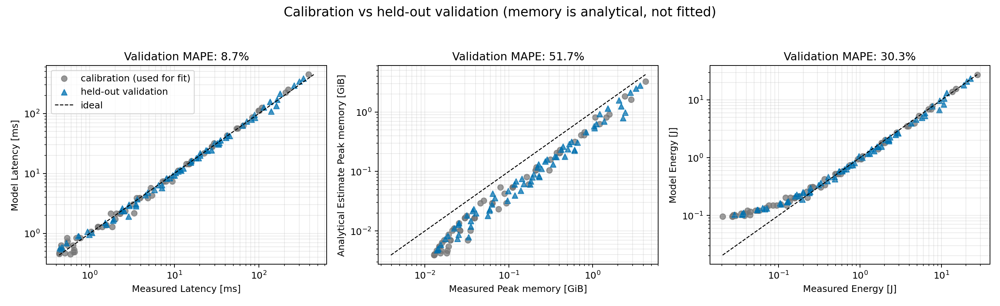
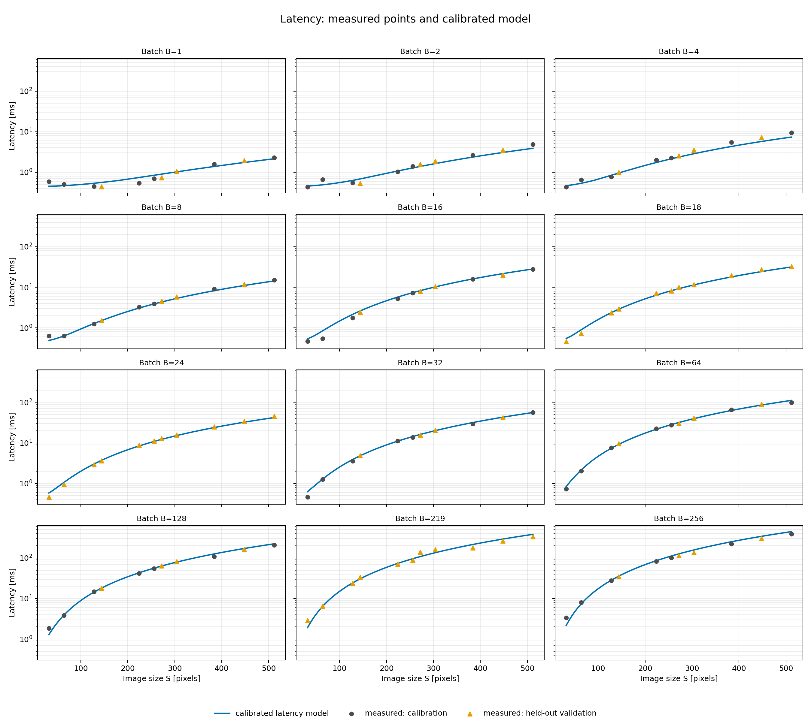
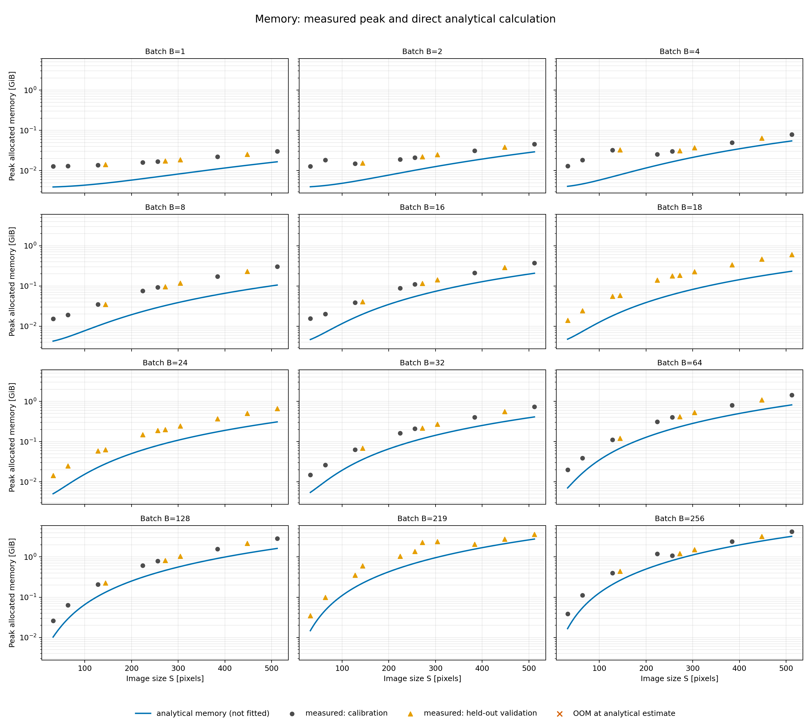
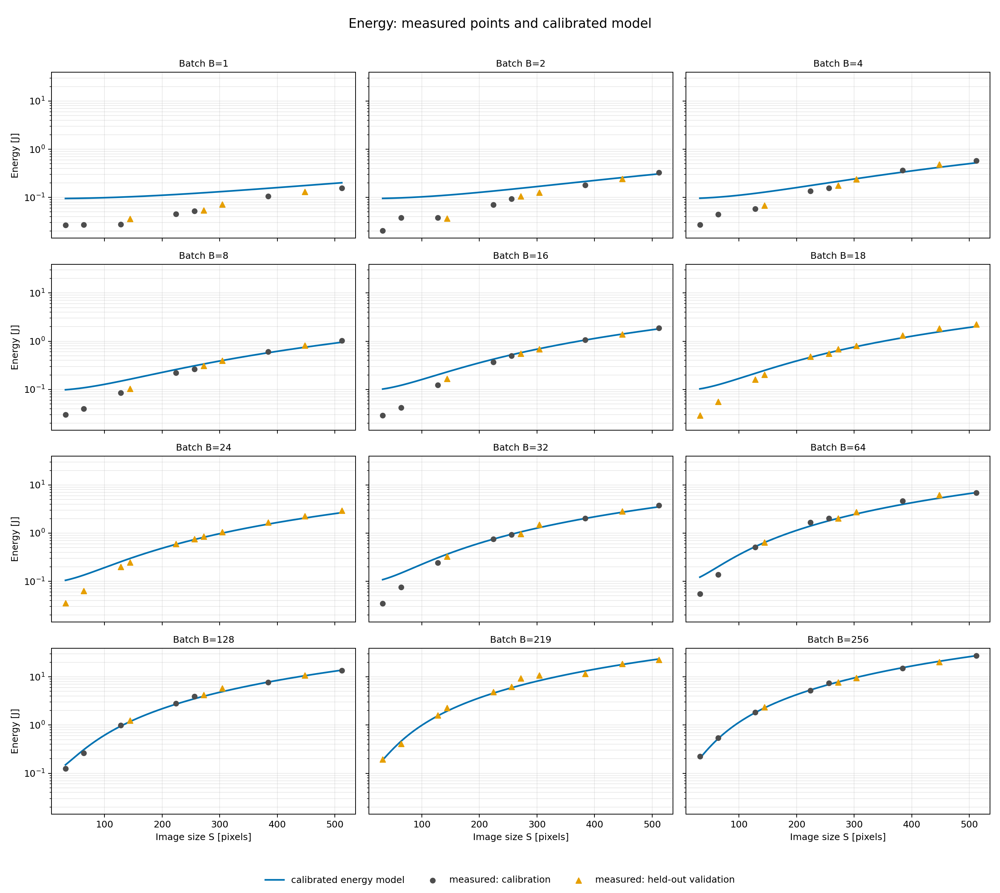
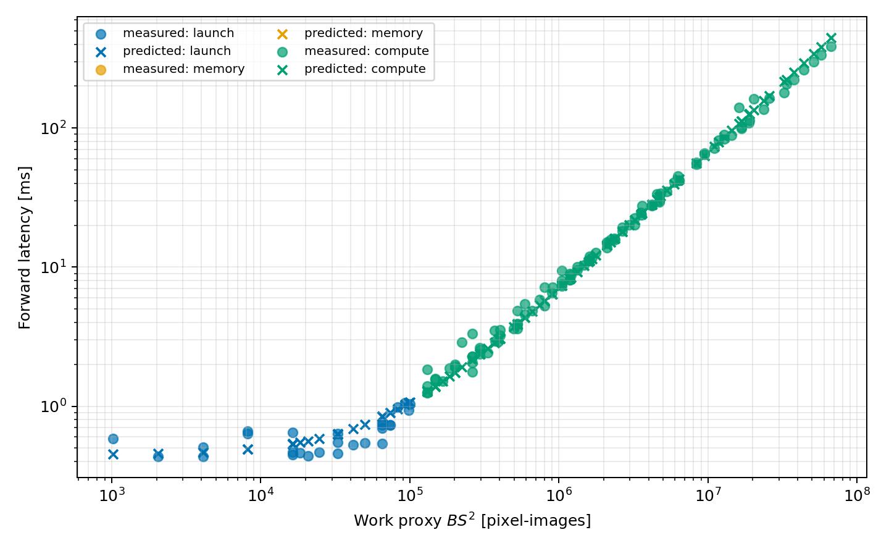

# Homework 1 — аналитическая модель производительности CNN

Для заданной CNN выведены функции `FLOPs`, `Memory`, `Latency` и `Energy`, выполнены измерения на Tesla T4, параметры моделей подобраны только по calibration-части и проверены на отдельных validation-точках.

Рукописный вывод формул находится в [`hw1_handwritten.pdf`](hw1_handwritten.pdf). Код формул — в [`equations.py`](equations.py), сеть — в [`models.py`](models.py), измерения и калибровка — в [`measure.py`](measure.py) и [`calibrate.py`](calibrate.py).

## Сеть и формулы

Сеть: шесть сверток без bias, `ReLU(inplace=True)` после каждой свертки, один MaxPool, Global Average Pooling и классификатор `512→256→100`. Все измерения в FP32, `eval()` и `torch.inference_mode()`. Число параметров — 1 040 324.

При соглашении «один MAC = два FLOP» получены формулы:

```text
FLOPs(S,B)      = B (17 751 S² + 313 956)
Memory(S,B)     = 4 (1 040 324 + 13 B S²) bytes
BytesMoved(S,B) = 4 (91 B S² + 2 148 B + 1 040 324) bytes
```

Для 17 последовательных операторов используется layer-wise roofline:

```text
Latency(S,B;θ) = Σ_l [t_launch + max(F_l(S,B)/P_eff, Q_l(S,B)/BW_eff)]
```

Энергия всей GPU на один forward в джоулях моделируется как:

```text
Energy(S,B;θ_E) = 17 e_launch
                + e_flop FLOPs(S,B)
                + e_byte BytesMoved(S,B)
```

Функции принимают числа и broadcast-совместимые NumPy-массивы.

## Эксперимент

- GPU: Tesla T4, 14.56 GiB; driver 580.82.07.
- Python 3.13.15; PyTorch 2.11.0+cu130; CUDA 13.0; cuDNN 9.2.7.
- `cudnn.benchmark=False`; TF32 выключен.
- Сетка: 11 размеров изображения × 12 batch size = 132 уникальные конфигурации.
- Calibration: 63 точки базовой сетки. Validation: 69 точек, содержащих хотя бы одну случайную координату; они не использовались при подборе параметров.
- Latency: медиана повторных измерений CUDA Events.
- Memory: `torch.cuda.max_memory_allocated()`.
- Energy: накопительный счётчик NVML, энергия всей GPU на один forward.

Полное окружение сохранено в [`results/environment.json`](results/environment.json), параметры — в [`results/theta.json`](results/theta.json), метрики — в [`results/analysis_summary.json`](results/analysis_summary.json).

## Результаты на held-out validation

| Величина | MAPE | Median APE | R² |
|---|---:|---:|---:|
| Latency | 8.66% | 6.14% | 0.974 |
| Memory | 51.72% | 52.34% | 0.785 |
| Energy | 30.28% | 9.20% | 0.988 |

Все 132 точки завершились успешно. OOM не возник: максимальный измеренный peak — 4.26 GiB при 14.56 GiB доступной памяти; аналитическая оценка для самой тяжелой точки — 3.25 GiB. При возникновении ошибки `measure.py` ловит `torch.cuda.OutOfMemoryError` и записывает статус `OOM`.

Модель latency хорошо переносится на невидимые точки. По суммарному времени 27 конфигураций классифицированы как launch-bound, 105 — как compute-bound и 0 — как memory-bound, при этом отдельные операторы (ReLU, pooling, GAP и часть linear/conv) memory-bound; просто их вклад не становится крупнейшим для всего forward.

Аналитическая memory систематически ниже измеренной, потому что формула намеренно считает только параметры и живые тензоры, а PyTorch также учитывает cuDNN workspace и служебные буферы.

У energy высокий средний процент ошибки в основном на самых маленьких значениях энергии, где ограничена точность счетчика; median APE 9.20% и R² 0.988.

## Результаты

### Предсказания и реальные измерения

Серые круги использовались для калибровки, синие треугольники относятся к отдельной validation-выборке. Latency и Energy в основном расположены около диагонали; аналитическая memory ниже реального пика.



### Latency для разных batch size

Каждая панель соответствует одному batch size. Синяя линия — модель latency, круги — calibration-точки, треугольники — held-out validation. График показывает, что модель воспроизводит рост времени при увеличении размера изображения и переносится на координаты, которые не участвовали в калибровке.



### Peak memory для разных batch size

Синяя линия — прямой аналитический расчет памяти, точки — значения `torch.cuda.max_memory_allocated()`. Измерения выше формулы из-за workspace cuDNN и служебных буферов PyTorch, которые не входят в аналитическую модель. Красных отметок OOM нет, поскольку все 132 конфигурации поместились в память T4.



### Energy для разных batch size

Синяя линия — калиброванная модель энергии всей GPU на один forward. Точки показывают реальные измерения NVML. Модель хорошо описывает общий рост энергопотребления; наиболее заметная относительная ошибка возникает у маленьких конфигураций, где измеряемая энергия очень мала.



### Режимы latency

По горизонтали показан объем работы `B·S²`, по вертикали — latency. Круги обозначают измерения, иксы — предсказания. Синие точки относятся к launch-bound режиму, зеленые — к compute-bound. Отдельного end-to-end memory-bound участка в измеренной сетке нет, хотя некоторые слои сети ограничены пропускной способностью памяти.



Исходные PNG находятся в [`results/figures/`](results/figures/).

## Воспроизведение

```bash
python3 -m venv .venv
.venv/bin/pip install -r requirements.txt
.venv/bin/python -m unittest discover -s tests -v
.venv/bin/python measure.py
.venv/bin/python calibrate.py
.venv/bin/python plots.py
```

Итоговые данные находятся в [`results/measurements.csv`](results/measurements.csv), а все пять графиков строятся командой `plots.py`.
